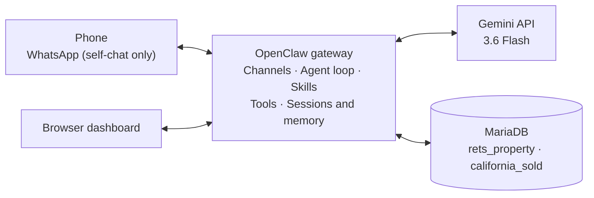
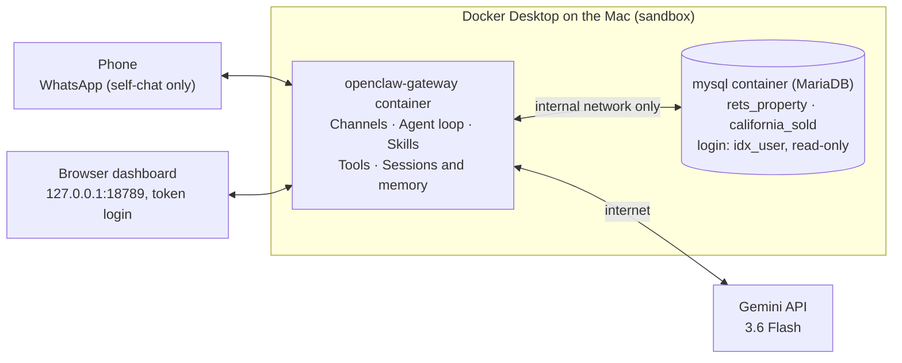

# IDX-Exchange-Agentic-AI

## Architecture

### System at a glance

| Part | What it is |
|---|---|
| Agent runtime | OpenClaw 2026.9.7, one agent named `main` |
| Model | Gemini 3.6 Flash (backup: Gemini 3.8 Flash) |
| Channels | WhatsApp (self-chat only) and the web dashboard |
| Database | MariaDB with `rets_property` (55,212 active listings) and `california_sold` (98,552 sold records) |
| Hosting | Docker Desktop on a Mac (see the Docker note below) |
| Skills | `current-time` (Week 1); `parse-property-query` and `property-search` added in Weeks 2–3 |

### How everything connects

#### Without Docker: what talks to what

- **Gateway:** OpenClaw's main program, always running. It receives every message, asks Gemini what to do, runs the tasks Gemini asks for, and sends the reply back.
- **Channels:** messages arrive from WhatsApp or the browser dashboard. WhatsApp is locked to the owner's own number.
- **Gemini:** the AI model that decides how to answer and which skill to use.
- **Skills and tools:** skills are instruction files that tell the agent how to do a task. Tools are the actions it runs, like a database search.
- **Database:** MariaDB holds the MLS data. The agent's login can only read.
- **Sessions and memory:** the gateway saves each chat's history, so follow-up questions make sense.

#### With Docker: how it actually runs

Same parts and connections, but sealed inside Docker: only the gateway can reach the outside world, and the database has no internet access at all.

### Architecture flow: one question, start to finish

1. The user sends a question to their own WhatsApp chat.
2. The gateway checks that the message comes from an approved number, then opens this chat's history.
3. The agent loop builds a package for Gemini: the agent's instructions, the list of skills it can use, what it remembers about the user, and the chat so far.
4. Gemini picks the matching skill and replies with a tool call (a request to run a task) instead of an answer.
5. The gateway runs the tool.
6. The tool queries the database, which returns the matching rows.
7. The tool hands the results back to the gateway, which sends them to Gemini.
8. Gemini writes the final answer.
9. The gateway adds the question and answer to the chat history, so a follow-up question makes sense.
10. The reply goes back to the WhatsApp chat.

## Note: why I used Docker

I ran it in **Docker** instead, as a sandbox, because an AI agent can run commands and a bad prompt could trick it into doing something unsafe.

- **What Docker limits:** the agent runs as a non-root user with no special system permissions and capped memory/CPU, and it can only see one project folder, not the rest of the Mac.
- **Three containers:** `openclaw-gateway` (the agent), `mysql` (MariaDB with the MLS data) and a small one-time helper that sets file permissions.
- **Extra safeguards:** the database is on an internal network with no internet access, the agent's database login is read-only, secrets stay in a `.env` file that is never committed, and the dashboard only accepts connections from the Mac itself.
- **What Docker doesn't protect:** connected accounts. The agent can still use whatever it's given (the Gemini key, the linked WhatsApp), which is why WhatsApp is locked to the owner's number.
- **Why MariaDB:** the MLS `.sql` files were exported from MariaDB, so the same database is used to avoid import problems.
